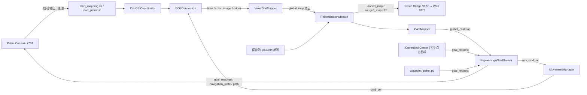

# DimOS Go2 仓库巡检工作流

本目录提供从遥控采图到自动巡检的两阶段流程：先录制并生成可复用地图，再加载地图、自动定位并执行可配置的航点任务。

> **当前成熟度**：仿真流程已经在本机跑通。真机模式使用 Unitree WebRTC 连接，但在开放真实 Go2 前必须先在安全的封闭区域验证制动、路线、初始位姿和失联处理。该方案不是经过安全认证的工业 AMR 控制器。

## 1. 目录与入口

| 文件 | 用途 |
|---|---|
| `start_patrol_console.sh` | 启动本地调度/监控平台，默认地址 `http://127.0.0.1:7781/` |
| `start_mapping.sh [地图名]` | 启动 Go2 遥控采图和实时可视化；停止后自动优化并导出地图 |
| `export_map.sh 录制.db 输出.pc2.lcm` | 从已有录制补做点云地图导出 |
| `start_patrol.sh 路线.json 地图.pc2.lcm` | 启动地图加载、定位和巡检执行 |
| `patrol_route.json` | 命令行默认路线示例 |
| `routes/` | 调度台保存的具名巡检路线 |
| `maps/` | 数据库、点云地图、Rerun 回放和运行日志 |
| `waypoint_patrol.py` | 下发巡检航点、停留、循环调度并写实时任务状态 |

## 2. 部署准备

### 软件

使用本项目的 Python 3.12 虚拟环境，并确认 DimOS、MuJoCo、Unitree 和 PGO/mapping 依赖均在同一环境：

```bash
cd /home/cy/Dimos/dimensional-applications
.venv/bin/python -m pip install 'dimos[base,unitree,sim,mapping]'
```

不要用裸 `pip`；本机 Conda 的 `pip` 曾与项目 venv 不匹配。建图后的 `--pgo` 依赖 `gtsam`，由 `mapping` extra 提供。

**发布/重建环境注意：** 本工作区当前使用的 `.venv` 中，`dimos/mapping/relocalization/module.py` 已有本项目所需的增强：启动即发布 `loaded_map`、`initial_pose`、`min_local_points`、`transform_file`。这些改动目前位于已安装的 DimOS 包，不在本目录的 Python 源码中；重建 venv 或重新安装上游 `dimos` wheel 会覆盖它们。部署到机器人前，应把这些变更合并进你使用的 DimOS fork 并构建/安装固定 wheel，再按本 README 安装应用依赖。

### Linux 网络

DimOS 的 LCM 进程通信需要 loopback multicast。若启动时提示系统配置，请在有权限的主机终端一次性配置；受限容器/VS Code 环境若启用了 `no new privileges`，无法在容器内通过 `sudo` 修复，需要在宿主机配置：

```bash
sudo ip link set lo multicast on
sudo ip route add 224.0.0.0/4 dev lo
sudo sysctl -w net.core.rmem_max=67108864
sudo sysctl -w net.core.rmem_default=67108864
```

若路由已存在，`ip route add` 返回 `File exists` 可忽略。检查：

```bash
ip link show lo
ip route show 224.0.0.0/4
sysctl net.core.rmem_max net.core.rmem_default
```

### 真机网络

- 运行 DimOS 的 Linux 主机和 Go2 必须能互相访问 Unitree 网络；设置正确的机器人 IP。
- 新固件可能需要 Unitree AES-128 key，可通过进程环境变量 `UNITREE_AES_128_KEY` 提供；不要把密钥写进路线或提交到 Git。
- WebRTC/LCM 多播、机器人网卡和主机防火墙配置依机器人网络拓扑而定。
- 默认只监听本机回环地址。远程电脑访问时优先使用 SSH 隧道，不要把无认证的控制台直接暴露到公网：

```bash
ssh -L 7781:127.0.0.1:7781 -L 7779:127.0.0.1:7779 \
    -L 9877:127.0.0.1:9877 -L 9878:127.0.0.1:9878 \
    -L 3030:127.0.0.1:3030 user@robot-host
```

## 3. 启动调度/监控平台

终端 A：

```bash
cd /home/cy/Dimos/dimensional-applications
./start_patrol_console.sh
```

浏览器打开 `http://127.0.0.1:7781/`。该界面包含采图任务、地图/路线选择、点云俯视编辑、巡检启动/停止和实时状态/日志。

其他服务端口：

| 端口 | 服务 | 内容 |
|---:|---|---|
| 7781 | Patrol Console | 调度和任务管理 UI |
| 7779 | Dimensional Command Center | 2D 地图、遥控、点击目标 |
| 9877 | Rerun gRPC proxy | Rerun 数据流 |
| 9878 | Rerun Web viewer | 浏览器 3D/点云视图 |
| 3030 | Rerun WebSocket | Viewer 输入/控制信号 |

Rerun Web 需要支持 WebGPU 的浏览器/驱动。若 VS Code 内置浏览器显示 `No available adapters`，请用外部 Chrome/Chromium，或运行原生 `dimos-viewer`。巡检控制台自身的点云路线编辑不依赖 WebGPU。

## 4. 功能一：遥控采图

在调度台选择“仿真”或“真机”，填写地图名称。真机模式还要填写 Go2 IP；AES key 预先通过 `UNITREE_AES_128_KEY` 环境变量注入。点击“启动采图”后打开 Command Center：

```text
http://127.0.0.1:7779/
```

采图蓝图 `unitree-go2-memory` 同时运行传感器、可视化与 `Go2Memory` Recorder。通常应**实时查看并录制原始数据，停止后离线执行 PGO 和体素融合**：实时查看便于发现漏扫；离线 PGO 可以利用整段轨迹做回环优化，通常比边走边冻结地图质量更好。录制包含 LiDAR、odom、相机图像及 TF，数据库写在 `maps/<名称>.db`。

覆盖完区域后点击“结束采集并导出地图”（或采图终端按 `Ctrl+C`）。脚本会等待 recorder 结束，再执行：

```bash
./export_map.sh maps/warehouse.db maps/warehouse.pc2.lcm
```

输出：

- `maps/warehouse.db`：原始传感器/位姿录制，可用于重建或回放。
- `maps/warehouse.pc2.lcm`：供重定位和代价图使用的优化点云地图。
- `maps/warehouse.rrd`：离线地图/轨迹可视化回放。

### 如果地图导出中断或 `.pc2.lcm` 缺失

原始录制仍在时，可以在项目根目录手动补导出：

```bash
./export_map.sh maps/warehouse.db maps/warehouse.pc2.lcm
```

不要删除 `.db-wal`/`.db-shm` 或在 recorder 仍运行时导图；先正常停止采集。导图需要 PGO/mapping extra，耗时可能是数分钟。

## 5. 功能二：配置路线并自动巡检

### 配路线

在调度台选择 `.pc2.lcm` 地图。点云背景采用米制 XY 坐标：

1. 点击“设置唯一出发 / 返回点”，再在地图点一下设置起点和最终返航点。
2. 在地图上按顺序点击巡检点；右键移除末尾点。可点击“优化巡检顺序”按 XY 直线距离优化往返顺序；这是几何近似，不计算障碍物绕行代价。
3. 每个点的 X、Y、停留秒数可在表格中单独修改，确认后在地图工作区直接保存路线。
4. 巡检任务设置中的启动方式、预约时间、任务时长和循环间隔只作用于本次运行，不写入 UI 保存的路线几何。

路线 JSON 示例：

```json
{
  "return_to_start": {"x": -1.0, "y": 1.0},
  "waypoints": [
    {"x": 4.0, "y": 5.0, "dwell_s": 10},
    {"x": -1.7, "y": 5.0, "dwell_s": 30}
  ]
}
```

起点/返回点只在首次出发前导航到达一次，并在任务最终结束时返航一次；循环轮次之间不回家，直接从上一轮最后一个巡检点导航到下一轮第一个点。每个航点到达后按 `dwell_s` 停留。任务设置中的“持续循环至任务时长”会重复执行路线直到时长结束；循环间隔为 0 表示本轮结束后立即启动下一轮。选择“只运行一轮”则单次经过所有巡检点后返航。选择“立即开始”会在定位成功后开始；“预约一次”会在下一个指定的本地时刻执行一次，若今天该时间已过则等到次日。总时长和循环间隔只作用于本次运行；手动结束或时长到期时，会从当前位置导航回家。

### 启动巡检任务

在调度台确认地图、路线和设备模式后点击“确认并启动巡检”。系统顺序为：

1. 加载预建地图，并将地图立即送入 Rerun。
2. 启动 Go2 传感器和定位/规划模块。
3. 等待日志出现有效 `relocalize: fitness=...`；定位未成功不会下发运动目标，超时会报错停止。
4. 到达起点后按顺序发送 `/goal_request`，监控 `/goal_reached`；循环之间不返回起点，任务结束时仅返航一次。
5. 火情/异常时可用“火情 / 异常：暂停”取消当前导航；由操作员确认现场安全后点击继续，执行器会重新发送被中断的目标。火情状态尚未接入时显示 `NaN`；暂停/恢复事件会记录为 `Fire_alarm` / `Safe`，追加写入 `maps/fire-alarm-events.jsonl`。检测适配器可调用 `POST /api/fire-signal` 并传入 `{"state":"Fire_alarm"}` 或 `{"state":"Safe"}`。当前项目尚未集成火情检测器；软件暂停不代替硬件急停。
6. 点击“结束巡检并返航”会设置优雅停止请求，让机器人从当前位置返回路线 home 点后关闭运行栈。任务总时长到期同样会触发返航。
7. 调度台每 2 秒刷新任务阶段、周期、当前目标点和运行日志。

命令行也可启动一次巡检（仿真）：

```bash
DIMOS_MODE=simulation ./start_patrol.sh routes/warehouse-patrol.json maps/warehouse.pc2.lcm
```

通过命令行持续循环到路线配置的时长结束，可设置 `PATROL_REPEAT_ENABLED=1`；`PATROL_REPEAT_INTERVAL_S=0` 表示每轮结束立即接下一轮。默认命令行仍为单轮，以免旧脚本意外无限运行。控制台会显式选择“只运行一轮”或“持续循环至任务时长”。

未来火情检测器可向本机控制台发送 `POST /api/fire-signal`，JSON 状态只接受 `Fire_alarm` 或 `Safe`，可选 `source` 字段记录传感器名称。事件逐行追加到 `maps/fire-alarm-events.jsonl`；未接入或尚无信号时状态为 `NaN`。

真机命令：

```bash
DIMOS_MODE=real ROBOT_IP=192.168.123.161 \
UNITREE_AES_128_KEY="$UNITREE_AES_128_KEY" \
./start_patrol.sh routes/warehouse-patrol.json maps/warehouse.pc2.lcm
```

若真机从固定充电桩/起点启动，可设置 `DIMOS_INITIAL_POSE='x,y,yaw'`（米、弧度）；留空则不注入 identity 初值，依赖实时点云全局匹配。首次部署不要未经验证就在开放区域自动运动。先用低速、短路线、人工急停观察定位 fitness 和实际坐标；`identity` 只用于仿真或坐标已知且经测量确认的固定起点。

## 6. 模块与交互信号



主要 topic：

| Topic | 类型 | 方向/用途 |
|---|---|---|
| `/lidar` | `sensor_msgs.PointCloud2` | Go2 实时 LiDAR；定位、临时地图和避障输入 |
| `/color_image` | `sensor_msgs.Image` | Go2 RGB 相机图像 |
| `/odom` | `geometry_msgs.PoseStamped` | Go2 当前里程计位姿 |
| `/loaded_map` | `sensor_msgs.PointCloud2` | 已加载的静态预建地图 |
| `/merged_map` | `sensor_msgs.PointCloud2` | 定位成功后的先验地图与当前扫描融合输出 |
| `/global_costmap` | `nav_msgs.OccupancyGrid` | 从点云生成的二维地形/障碍代价图 |
| `/goal_request` | `geometry_msgs.PoseStamped` | Command Center 或巡检执行器下发目标 |
| `/path` | `nav_msgs.Path` | A* 当前规划路径 |
| `/nav_cmd_vel`、`/cmd_vel` | `geometry_msgs.Twist` | 规划速度与运动仲裁后的机器人控制 |
| `/goal_reached` | `std_msgs.Bool` | 到达目标的完成信号 |
| `/navigation_state` | `std_msgs.String` | 当前导航状态 |
| `/tf` | `tf2_msgs.TFMessage` | TF 广播；`RelocalizationModule` 的 `world <- map` 对齐变换会另存为 `maps/map-to-world.json` |
| WebSocket `click` | XY 点 | Command Center 点击地图发目标 |
| WebSocket `move_command` | Twist 量 | Command Center 手动遥控 |

重定位日志中的 `fitness` 是点云匹配质量；调度台只在匹配有效后启动任务。当前算法以约 2 秒间隔做全局匹配，局部规划/里程计的更新频率更高。路线文件中的起点/巡检点是保存地图坐标；启动任务时巡检执行器读取最新 `world <- map` 变换，将每个地图坐标转换为当前规划器的 world 坐标后才发 `/goal_request`。变换文件缺失/损坏时执行器会拒绝移动。真机生产部署仍需实测定位漂移、动态障碍、急停和失联保护。

## 7. 启停和故障排查

- 调度台：`./start_patrol_console.sh`，然后打开 `http://127.0.0.1:7781/`。
- 如果 7781 被占用，检查旧控制台进程；DimOS 另有 `dimos status` / `dimos stop`。
- 建图期间结束任务用 UI 的停止按钮或采图终端 `Ctrl+C`；等待日志确认 PGO 导图完成。
- 检查地图文件：`ls -lh maps/*.db maps/*.pc2.lcm maps/*.rrd`。
- 查看巡检进度文件：`cat maps/patrol-status.json`；巡检日志：`maps/patrol.log`、`maps/patrol-dimos.log`。
- 如果定位失败，先确认地图与当前仓库相同、机器人启动位置在地图覆盖范围内、LiDAR 有数据且 `fitness` 达标；不要通过盲目降低阈值来强行行驶。
- 页面远程访问优先走 SSH 隧道。Flask 控制台当前无用户认证，只监听 loopback；不要直接公开到公网。

## 8. 功能边界

目前采图记录和 PGO 地图导出是离线两阶段的；运行巡检时会持续读取 LiDAR 做定位与障碍感知。当前 relocalization blueprint 仍会在内存中融合运行时扫描，静态地图文件不会被覆盖。路线坐标以本次导出的地图平面坐标为准；更换/重建地图后应重新核验航点。

Console 的“实时回传”目前是任务阶段/当前航点/日志轮询；高频 LiDAR、图像、TF 可通过 Command Center 与 Rerun 查看。若要产品级可靠性，还需补充用户认证、断网自治策略、任务持久队列、硬件急停接入、导航失败后的人工接管，以及仓库动态障碍专项测试。

## 9. Unitree Go2 EDU 到货验收

### 当前项目状态

本机已验证：`warehouse.db → warehouse.pc2.lcm` 导图、点云路线控制台、仿真定位 fitness、路线状态 API 和 map→world 二维坐标换算。**尚未用实际 Go2 EDU 验证**无线网络、WebRTC/AES、真机 LiDAR/相机流、真机坐标系、制动距离、避障性能或返航精度；仿真通过不等于真机验收通过。

另外，执行 `.venv/bin/dimos status` 和端口检查确认机器人服务是否正在运行。调度 UI 在 `7781` 单独运行不代表机器人已连接。开始新的 Robot 测试前要关闭旧 DimOS 仿真/真机实例，避免 7779/9877/9878/3030 端口冲突。

### A. 到货与静态检查（不启动 DimOS）

- 核对 Go2 EDU 型号、序列号、固件版本、电池、充电器、急停/遥控器和随机线材。
- 检查机身、腿部关节、相机窗口、LiDAR 窗口和电池无运输损伤；记录固件与序列号，不要把 AES key 写入仓库。
- 在 Unitree 官方遥控/配套流程中确认电池、电机和急停状态正常；第一次运动必须在平整、空旷、围挡/隔离的区域，地面放置、保持急停/遥控器在操作员手边。不要架空、放桌面或在人群旁启动：当前 DimOS Go2 connection 在 `start()` 中会调用 standup/balance-stand。
- 准备能直接断电/急停的操作员和观察员。未验证前不接自动路线、不设置无人值守定时任务。

### B. 主机与机器人网络检查（不发导航目标）

1. 主机加入与机器人相同且允许 UDP/WebRTC 通信的网络；为机器人 IP 设置 DHCP reservation/静态地址。
2. `ping "$ROBOT_IP"` 仅作基础连通性检查，不代表 WebRTC 已连通。确认防火墙、Wi-Fi 隔离和 VLAN 策略不会阻断主机与机器人通信。
3. 在终端设置 `DIMOS_MODE=real`、`ROBOT_IP`；若该固件要求 AES key，再由环境变量提供。确认 DimOS `--help` 中的真实机 IP/AES 选项和固件要求，绝不把密钥粘进 README、路线 JSON 或 shell history。
4. 在机器人未被支撑、急停随时可触及且周围清空时，启动真机传感器流程。注意它不是纯被动“只看传感器”模式，会执行站立动作；如要纯只读验收，先用 Unitree 官方工具确认传感器，或先开发/部署禁用 standup 的专用传感器蓝图。

**通过条件：** WebRTC handshake 成功；能持续收到 LiDAR、相机、odom；控制台/Rerun 连续运行至少 5 分钟，无断连、内存耗尽或 worker 重启。图像应随镜头/环境改变，点云有合理距离/方向，odom 静置时不跳变。若连接失败，先停机查 IP、Wi-Fi/路由、防火墙和 AES/固件兼容，不要反复重启让机器狗重复站立。

### C. 急停与低速手动控制

- 先用官方遥控器确认站立/趴下和急停工作。
- 使用 DimOS 手动遥控时，先仅做极短的前进、后退、转向测试；每次一个方向、低速、少于 0.2–0.3 m，停止后确认零速命令能立即生效。
- 测试人在旁边随时按官方急停；不要用“断开浏览器/杀 Python”代替急停验收。
- 验证过程不要同时运行巡检脚本，不要从多个控制台同时发速度命令。

**通过条件：** 控制方向正确；松开控制/停止命令后机器人停止；急停能覆盖软件指令；恢复急停后需要明确的人工复位流程。

### D. 真机建图验收

1. 调度台选“真机”，填地图名和 robot IP，点击“启动采图”。
2. 遥控机器人以慢速覆盖一个小型、静态、容易回到起点的区域；保持可视化显示 LiDAR、图像和 odom。
3. 停止采集，等待 PGO 导图完成；核对 `maps/<名称>.db`、`.pc2.lcm`、`.rrd` 均存在且非零。
4. 在路线控制台加载该地图，看墙面/通道是否闭合、比例是否合理、机器人轨迹是否与点云重合；明显重影/弯墙/错层时不要进入自动巡检。

**通过条件：** 小范围地图可重复打开；机器人走过的固定墙/货架没有明显双层错位；图像、点云和地图坐标方向一致；DB、map、RRD 可复制备份。

### E. 定位与航点闭环验收（先不循环）

1. 在路线 UI 选刚建的真机地图和测试路线。将路线起点设为机器人实际开机位置；真机的 `identity` 初值只可用于已标定的固定起点，否则留空，依赖全局点云匹配。
2. 启动巡检。脚本先等待 `relocalize: fitness=...` 和新鲜的 `maps/map-to-world.json`，定位超时会拒绝发送路线目标。
3. 检查状态 UI 显示的 `Map→World` 对齐、fitness、map/world 目标坐标；先下发 1 个近距离航点（0.5–1m），观察实际方向与地图上预期一致。
4. 再测试 2–3 个点和单点停留。放置一个软质、可人工移除的障碍做低速避障观察，不用人或贵重设备充当障碍物。
5. 测试结束时间触发返航、到达返航点、停止按钮；最后才尝试重复间隔。急停始终由观察员掌控。

**必须记录：** 固件/序列号、主机与 robot IP、地图版本/hash、路线版本、定位 fitness 和 Map→World、点到达误差、停留时间误差、返航误差、急停/断网结果、所有失败日志。首次通过只表示受控试验通过，不代表可无人值守。

### F. Go/No-Go 门槛

以下全满足才进入小规模受监督试运行：定位在固定起点连续稳定；所有测试航点方向正确且误差符合你的仓库容差；动态/静态障碍测试可安全停止或绕行；急停始终有效；失联/定位失效时不继续盲走；超时能安全返航或停在安全位置；人员完成风险评估和恢复演练。任何一项不满足即 **No-Go**，停用自动巡检，仅保留人工遥控和采集。